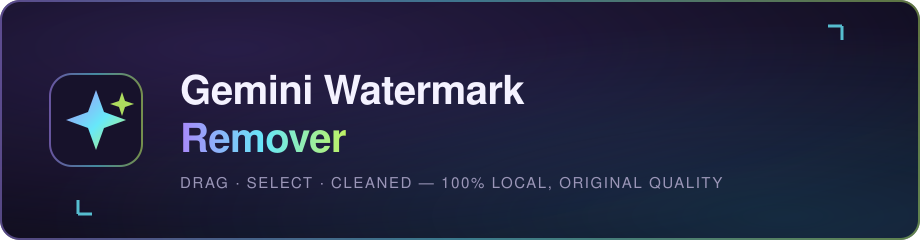

<div align="center">



# ✦ Gemini Watermark Remover

**Drag a box around the badge. Only those pixels change. Everything else stays byte-identical.**

Free · Open source · 100% local · No accounts, no limits, no watermarks on your output

[](https://www.python.org/)
[](https://flask.palletsprojects.com/)
[](https://opencv.org/)
[](https://ffmpeg.org/)
[](LICENSE)
[](#-quick-start)

**[Remove a watermark now](#-how-to-use) · [Deploy free](#-deploy-it-free) · [How it works](#-under-the-hood) · [FAQ](#-honest-limits--faq)**

</div>

---

## ✨ Why it's different

Most remoters blur a rectangle and hope you won't notice. This one is built on three non-negotiables:

| | Feature | What it means for you |
|---|---|---|
| ◎ | **Pixel-exact manual selection** | *You* draw the box — no AI guessing wrong and eating your content. A live preview shows the exact pixels before anything runs. |
| ⬚ | **Region-only editing** | Every pixel outside your box is **byte-identical** to the original. No global re-compression, no "enhancement". |
| ✦ | **Texture-aware inpainting** | Navier–Stokes fill + Telea fringe pass + **grain matching** — the patch blends into the surroundings instead of looking like a smooth sticker. |
| ▣ | **Original quality output** | Photos keep full resolution (quality 100). Video encodes **once** at x264 CRF 17 (visually lossless) — same resolution, same FPS, **original audio kept**. |
| ⚡ | **Genuinely fast** | Crop-only processing (~45 ms per 1080p frame) + single-pass streaming encode. A 1080p clip usually finishes in seconds. |
| ⌂ | **Private by design** | The engine runs on **your machine**. Nothing is ever uploaded, stored remotely, or used for training. |

> [!NOTE]
> **Video superpower:** you box the badge *once* — the tool samples 5 frames, unions their tight masks so background changes never break it, then cleans **every frame** of the whole clip with zero flicker.

---

## 🚀 Quick start

```bash
# clone & run
git clone https://github.com/<your-username>/gemini-watermark-remover.git
cd gemini-watermark-remover
pip install -r requirements.txt
python app.py
```

Open **`http://127.0.0.1:5000`** — or double-click **`start.bat`** on Windows.

> [!TIP]
> FFmpeg ships bundled via `imageio-ffmpeg` — there is **nothing else to install**. Python 3.10+ is all you need.

## 🕹 How to use

| Step | Action |
|:---:|---|
| **1 · Upload** | Drop a photo or video onto the drop zone (PNG · JPG · WebP · BMP · TIFF · MP4 · MOV · M4V · WebM · MKV · AVI) |
| **2 · Select** | Drag a tight box around the visible watermark. For videos, tap to play/pause and scrub to a sharp frame. A pixel-exact preview confirms the region. |
| **3 · Remove** | One click. Photos finish in seconds; videos are cleaned across every frame in a single pass. |
| **4 · Download** | Original-resolution image, or visually lossless MP4 with the original audio track. |

## ☁️ Deploy it free

The repo ships deploy-ready. Free tiers **sleep when idle** and have **ephemeral storage** — fine for a removal tool.

<details open>
<summary><b>Option A — Render (easiest)</b></summary>

1. Push this repo to GitHub
2. [render.com](https://render.com) → **New + → Blueprint** → pick your repo
3. The included `render.yaml` (Docker, free plan) is detected automatically → you get `https://<app>.onrender.com`

</details>

<details>
<summary><b>Option B — Hugging Face Spaces (most free RAM — best for video)</b></summary>

1. New Space → SDK: **Docker**
2. Point it at your GitHub repo (or upload the files)
3. The `Dockerfile` already listens on Spaces' expected port `7860` and declares OpenCV's system libs — free tier gives you 2 vCPU / 16 GB RAM

</details>

<details>
<summary><b>Option C — any Docker host</b></summary>

```bash
docker build -t gwm-remover .
docker run -p 5000:5000 gwm-remover
```

The app binds `0.0.0.0` and reads the `PORT` env var automatically.

</details>

> [!TIP]
> **SEO is pre-wired:** every page exists in **8 languages** (🇬🇧 English · 🇪🇸 Español · 🇩🇪 Deutsch · 🇫🇷 Français · 🇮🇹 Italiano · 🇵🇹 Português · 🇳🇱 Nederlands · 🇵🇱 Polski) with localized keywords, slugs stay English for stable URLs (`/es/remover`, `/de/faq` …), JSON-LD structured data (WebApplication / HowTo / FAQPage / Article / BreadcrumbList), `hreflang` alternates + `x-default`, and a `sitemap.xml` covering all 96 language×page URLs — all URLs auto-adapt to your deployed domain. After deploying, submit `/sitemap.xml` in [Google Search Console](https://search.google.com/search-console). Visitors on `/` are auto-detected via `Accept-Language` and sent to their language landing.

## 🔌 API

```
POST /api/upload             multipart file            → { job_id }
POST /api/preview/<id>       { box:[x,y,w,h] }         → exact-region crop PNG
POST /api/process/<id>       { box:[x,y,w,h] }         → starts removal
GET  /api/status/<id>                                  → progress · logs · steps · region stats
GET  /api/download/<id>      ?view=1 previews inline   → cleaned file
```

<details>
<summary><b>🧠 Under the hood (click to expand)</b></summary>

- **Mask** — inside your box, bright badge pixels form a tight mask (fallback: box core), then dilated by 3×3. For video, masks from 5 sampled frames (start, quarters, middle, end) are **unioned**, so the badge is covered through background changes without the mask "breathing" between frames.
- **Fill** — `cv2.inpaint` (Navier–Stokes, radius 2) + a Telea pass on the fringe + noise matched to the local grain, so the repaired area doesn't look suspiciously smooth.
- **Video pipeline** — frames stream raw (`bgr24`) straight into ffmpeg's x264 in one pass: `veryfast` preset, CRF 17, `yuv420p`, audio copied as AAC 192k. No intermediate files, no double transcode.

```
├── app.py            Flask server + threaded job engine + i18n routing (/{lang}/… + Accept-Language detect)
├── remover.py        clamp_box · mask_from_box · clean_with_mask · remove_region
├── translations.py   8-language content engine (en · es · de · fr · it · pt · nl · pl) with EN fallback
├── static/
│   ├── site.css      shared styles for content pages + tool UI
│   └── favicon.svg
├── templates/        tool.html (localized UI) · landing.html · 10 dict-driven SEO pages × 8 languages
├── assets/banner.svg
├── Dockerfile        Render / HF Spaces / any Docker host
├── render.yaml       Render blueprint
├── Procfile          Python-runtime hosts
└── start.bat         Windows launcher
```

</details>

## ⚠️ Honest limits & FAQ

<details>
<summary><b>Does it remove Google's invisible SynthID?</b></summary>

**No — and we won't pretend otherwise.** The tool erases the *visible* badge only. SynthID is a statistical signature spread across the whole image, not a corner graphic. This tool doesn't add, remove, or alter hidden watermarks.

</details>

<details>
<summary><b>Will my quality drop?</b></summary>

No. Photos save at original resolution at quality 100. Video encodes once at x264 CRF 17 (visually lossless) with identical resolution, FPS, and audio. Pixels outside your selection are untouched.

</details>

<details>
<summary><b>Is it legal?</b></summary>

**Use it only on content you own or have rights to modify** — e.g. media you generated yourself. Removing badges from other people's content to misrepresent its origin may violate their terms and local law. Not affiliated with or endorsed by Google.

</details>

## 🤝 Contributing

PRs welcome! Areas that could use love: more inpainting backends (LAMA, LaMa-fast), a desktop build, more languages (add a dict in `translations.py` + one entry in `LANGS` — everything else is automatic). Please keep the zero-dependency-on-cloud promise.

## 📄 License

MIT — see [LICENSE](LICENSE)

<div align="center">

**If this saved you a manual blur session, a ⭐ is appreciated.**

*Runs 100% locally — nothing leaves your machine.*

</div>
